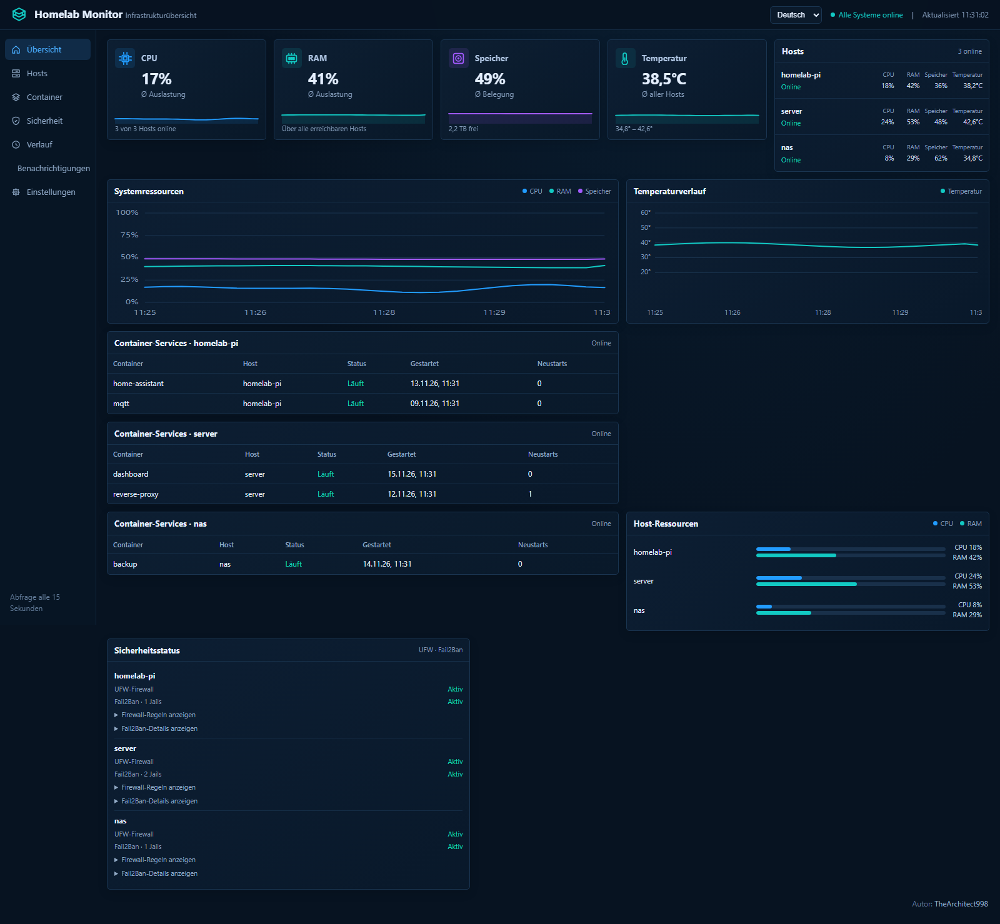

# HomeLab Dashboard

HomeLab Dashboard is a self-hosted monitoring dashboard for Linux hosts. It
provides system metrics, Docker and security information, persistent history,
and notifications via Telegram, Discord, Ntfy and Pushover. Temperature alerts
and a daily report with a configurable time help you monitor your homelab.

**Perfect for:** Home labs, small server farms, personal infrastructure monitoring.

---

## Table of Contents

- [Features](#features)
- [Architecture](#architecture)
- [Requirements](#requirements)
- [Quick Start](#quick-start)
- [Installation](#installation)
  - [Dashboard Setup](#dashboard-setup)
  - [Agent Setup](#agent-setup)
  - [Systemd Services](#systemd-services)
  - [Updating the Dashboard UI](#updating-the-dashboard-ui)
- [Configuration](#configuration)
- [Deployment Options](#deployment-options)
- [Security](#security)
- [Troubleshooting](#troubleshooting)
- [Contributing](#contributing)
- [License](#license)

---

## Features



The screenshot uses synthetic example data.

- CPU, RAM, root filesystem and temperature monitoring
- Persistent per-host metrics history: one sample per minute, retained for 30 days
- Docker container status, start times and restarts
- UFW and Fail2Ban status where configured
- Telegram, Discord, Ntfy and Pushover notifications
- Per-host temperature alerts and a daily report with a configurable time
- Password-protected dashboard and optional agent authentication
- German, English and French interface; light and dark themes
- Native Linux or Docker deployment on AMD64 and ARM64

---

## Architecture

```
┌───────────────────────────────────────────────────┐
│              Dashboard Host (Pi 1)                │
│  ┌─────────────────────────────────────────────┐  │
│  │          Web UI (FastAPI + HTML)            │  │
│  │       Aggregates metrics from agents        │  │
│  └─────────────────────────────────────────────┘  │
└───────────────────────────────────────────────────┘
                         ↓
         ┌───────────────┬───────────────┐
         ↓               ↓               ↓
    ┌─────────┐     ┌─────────┐     ┌─────────┐
    │ Agent   │     │ Agent   │     │ Agent   │
    │ (Pi 2)  │     │ (NAS)   │     │ (Other) │
    └─────────┘     └─────────┘     └─────────┘
```

**How it works:**
1. Dashboard runs a FastAPI server exposing a web UI
2. One or more lightweight agents run on monitored devices
3. Agents expose `/api/metrics` endpoint
4. Dashboard polls agents and aggregates the data
5. Web UI auto-refreshes every 15 seconds

---

## Requirements

**Dashboard Host:**
- Python 3.11+
- pip / venv
- Linux (systemd-enabled, recommended)

**Agent Hosts:**
- Python 3.11+
- pip / venv
- Linux (systemd-enabled, recommended)
- Optional: UFW, Fail2Ban, Docker (for full feature set)

---

## Quick Start

### 1. Clone the repository

```bash
git clone https://github.com/TheArchitect998/HomeLab-Dashboard.git
cd HomeLab-Dashboard
```

### 2. Create virtual environment

```bash
python3 -m venv venv
source venv/bin/activate
pip install --upgrade pip
pip install fastapi uvicorn httpx psutil
```

### 3. Configure dashboard

```bash
cp .env.example .env
# Edit .env and add your agent URLs
nano .env
```

Example `.env`:
```env
DASHBOARD_HOST=0.0.0.0
DASHBOARD_PORT=8888
AGENT_URLS='["http://pi-1.local:9100/api/metrics","http://pi-2.local:9100/api/metrics"]'
AGENT_KEY=your-long-random-agent-key
HOMELAB_STATE_DIR=/opt/homelab-dashboard/state
```

`AGENT_KEY` must match `HOMELAB_AGENT_KEY` on each agent. Protect `.env` from other users. `AGENT_URLS` accepts the existing `/api/metrics` URLs or agent base URLs; names remain `agent-1`, `agent-2`, and so on.

### 4. Set the first password locally

The state directory must be writable only by the dashboard service user. Replace `user` with your actual service user:

```bash
sudo install -d -o user -g user -m 0700 /opt/homelab-dashboard/state
sudo chown user:user .env
sudo chmod 600 .env
set -a
source .env
set +a
python dashboard_api.py setup
```

Set a password of at least 12 characters. For a service installation, run the setup command as the same user as the dashboard, with the same `HOMELAB_STATE_DIR`. The password can later be changed under Settings.

### 5. Start dashboard

```bash
source venv/bin/activate
set -a
source .env
set +a
uvicorn dashboard_api:app --host 0.0.0.0 --port 8888
```

Open `http://localhost:8888` locally and sign in. Use trusted HTTPS for network access; HTTP exposes credentials and session cookies.

---

## Docker Compose

Both dashboard and agent images can be built on Linux AMD64 and ARM64.
No prebuilt public image is required.

### Dashboard

```bash
cp backend/config.example.py homelab-dashboard.config.py
```

Edit `homelab-dashboard.config.py`: set the agent addresses and a strong
`AGENT_KEY` shared with the agents. Protect this file; it may contain secrets.
The container runs as UID/GID 10001 and must be able to read it. Agent
`127.0.0.1` addresses refer to the dashboard container itself.

By default, Compose mounts `./homelab-dashboard.config.py` relative to the
Compose project. Set `HOMELAB_CONFIG_PATH` to an absolute path on the Docker
host to use a protected configuration file elsewhere, for example when
deploying a Git stack through Dockhand and Hawser. The file must already
exist, and UID/GID 10001 must be able to traverse its parent directories and
read it. Do not commit the configuration file or its secrets.

```bash
docker compose build
docker compose run --rm dashboard python dashboard_api.py setup
docker compose up -d
```

The dashboard listens on `127.0.0.1:8888` by default. Set
`HOMELAB_BIND_ADDRESS` and optionally `HOMELAB_PORT` for a protected LAN.
The default timezone is UTC; set `HOMELAB_TIMEZONE`, for example to
`Europe/Berlin`, and recreate the container to change it.

Settings and history are stored in the `dashboard-state` volume. Protect and
back up this volume. `docker compose down -v` deletes it.

### Agent

On each monitored Linux host, create a protected `.env` file containing the
same key as the dashboard:

```env
HOMELAB_AGENT_KEY=replace-with-a-strong-random-key
HOMELAB_AGENT_BIND_ADDRESS=127.0.0.1
```

```bash
chmod 600 .env
docker compose -f compose.agent.yaml up -d --build
```

Set `HOMELAB_AGENT_BIND_ADDRESS` to a suitable LAN IP for remote dashboard
access and restrict port 9100 with the host firewall. Agent communication is
unencrypted; use a trusted network or encrypted tunnel.

The agent reads host metrics and Docker status. Journal, UFW and Fail2Ban
access are disabled by default and require additional host access. Unavailable
sources are shown as unavailable. Docker Desktop reports the Docker Linux VM,
not the Windows or macOS host.

**Security:** Docker socket access effectively grants host-root privileges,
even when the socket mount is read-only. The read-only host-root mount may
expose sensitive files. Only run trusted images and restrict agent access.

#### Optional security sources

The container agent does not access the host journal, UFW or Fail2Ban by
default. Enable only the sources you need in a local copy of
`compose.agent.yaml`; keep the existing service settings and mounts.

For SSH and Fail2Ban events, mount the host directory containing its
`.journal` files read-only at `/host/journal`, and set
`HOMELAB_JOURNAL_DIR: /host/journal`. The directory is typically
`/var/log/journal/<machine-id>` or `/run/log/journal/<machine-id>`.
Journal access exposes sensitive logs.

For Fail2Ban status, set `HOMELAB_ENABLE_FAIL2BAN: "1"` and bind the host
socket `/run/fail2ban/fail2ban.sock` to the same container path. Socket access
allows administrative commands even with a read-only mount. The client in the
image must be compatible with the host's Fail2Ban server.

For UFW status on Linux, set `HOMELAB_ENABLE_UFW: "1"`, mount host `/etc/ufw`
read-only at `/etc/ufw`, remove `ports`, and set `network_mode: host` and
`cap_add: [NET_ADMIN]`. `NET_ADMIN` allows changes to the host firewall, and
the agent listens on all host addresses on port 9100. Restrict access with the
host firewall. Host networking and compatible UFW/iptables versions are required.

Recreate the container after changes and verify status and real events. Missing
permissions or sources remain unavailable; the daily report marks missing
event coverage as incomplete.

To build and publish multi-architecture images to your own registry, use
`docker buildx build --platform linux/arm64,linux/amd64` with the appropriate
Dockerfile, image tag and `--push`.

## Installation

### Dashboard Setup

#### Step 1: Prepare the host

```bash
# Create application directory
sudo mkdir -p /opt/homelab-dashboard
cd /opt/homelab-dashboard

# Clone repository
git clone https://github.com/TheArchitect998/HomeLab-Dashboard.git .

# Create virtual environment
python3 -m venv venv
source venv/bin/activate
pip install --upgrade pip
pip install fastapi uvicorn httpx psutil
```

#### Step 2: Configure environment

```bash
# Copy example configuration
cp .env.example .env

# Edit with your agent URLs
nano .env
```

Set your agent URLs (hostnames or IPs):
```env
DASHBOARD_HOST=0.0.0.0
DASHBOARD_PORT=8888
AGENT_URLS='["http://192.168.1.100:9100/api/metrics","http://192.168.1.101:9100/api/metrics"]'
AGENT_KEY=your-long-random-agent-key
HOMELAB_STATE_DIR=/opt/homelab-dashboard/state
```

Create the state directory and set the initial password as described in [Quick Start](#4-set-the-first-password-locally). Configure the same key on every agent.

#### Step 3: Test locally

```bash
source venv/bin/activate
set -a
source .env
set +a
uvicorn dashboard_api:app --host 0.0.0.0 --port 8888
```

Visit `http://localhost:8888` to verify the dashboard loads.

---

### Agent Setup

Run these steps on **each monitored device** (Pi 2, NAS, etc.).

#### Step 1: Prepare the host

```bash
# Create application directory (same path as dashboard)
sudo mkdir -p /opt/homelab-dashboard
cd /opt/homelab-dashboard

# Clone repository
git clone https://github.com/TheArchitect998/HomeLab-Dashboard.git .

# Create virtual environment
python3 -m venv venv
source venv/bin/activate
pip install --upgrade pip
pip install fastapi uvicorn psutil
```

#### Step 2: Configure agent

```bash
# Copy example configuration
cp homelab-agent.env.example homelab-agent.env

# Edit with a secure key
nano homelab-agent.env
```

Set a strong key:
```env
HOMELAB_AGENT_KEY=your-secure-random-key-here
```

#### Step 3: Configure optional security access

To read UFW and Fail2Ban status, review the provided sudoers template and
adjust its username and command paths for your host before installing it:

```bash
sudo install -m 0440 systemd/homelab-dashboard.sudoers /etc/sudoers.d/homelab-dashboard
sudo visudo -cf /etc/sudoers.d/homelab-dashboard
```

The template permits specific status commands rather than unrestricted access
to UFW and Fail2Ban. Journal access for SSH and Fail2Ban event notifications
must be configured separately. Grant it only after considering that system
logs can contain sensitive information.

#### Step 4: Test locally

```bash
source venv/bin/activate
set -a
source homelab-agent.env
set +a
uvicorn backend.agent:app --host 0.0.0.0 --port 9100
```

Test the agent:
```bash
curl -H "X-Agent-Key: $HOMELAB_AGENT_KEY" http://localhost:9100/api/metrics
```

---

### Systemd Services

#### Dashboard Service

Copy the example service file:

```bash
sudo cp systemd/homelab-dashboard.service.example /etc/systemd/system/homelab-dashboard.service
```

Edit as needed:
```bash
sudo nano /etc/systemd/system/homelab-dashboard.service
```

Key settings to verify:
- `User=` (your username)
- `WorkingDirectory=` (path to cloned repo)
- `EnvironmentFile=` (absolute path to the protected `.env`)

Enable and start:
```bash
sudo systemctl daemon-reload
sudo systemctl enable homelab-dashboard.service
sudo systemctl start homelab-dashboard.service
sudo systemctl status homelab-dashboard.service
```

#### Agent Service

Copy the example service file on **each agent host**:

```bash
sudo cp systemd/homelab-agent.service.example /etc/systemd/system/homelab-agent.service
```

Edit as needed:
```bash
sudo nano /etc/systemd/system/homelab-agent.service
```

Key settings to verify:
- `User=` (your username)
- `WorkingDirectory=` (path to cloned repo)
- `EnvironmentFile=` (path to homelab-agent.env)

Enable and start:
```bash
sudo systemctl daemon-reload
sudo systemctl enable homelab-agent.service
sudo systemctl start homelab-agent.service
sudo systemctl status homelab-agent.service
```

Check agent logs:
```bash
sudo journalctl -u homelab-agent.service -f
```

### Updating to v2.2.1

Update the dashboard backend, frontend and agents together. Back up the
dashboard state directory first, including its settings and SQLite databases.
Keep the existing `.env` and `AGENT_URLS`; the environment-based configuration
remains supported.

Install the updated dependencies on the corresponding hosts:

```bash
pip install -r backend/requirements-dashboard.txt
pip install -r backend/requirements-agent.txt
```

Restart the dashboard and agent services after updating their files. Docker
users can rebuild and recreate the corresponding Compose services instead.
Verify the dashboard, agent connectivity and notification settings afterwards.

### Updating the Dashboard UI

For a UI-only update, use a frontend version compatible with the installed
backend. Back up the deployed `frontend/index.html`, then copy the new
`frontend/index.html` from the checked-out release into the dashboard's
frontend directory. The dashboard reads this file on each page request, so a
service restart is not required for a UI-only update.

---

## Configuration

### Adding/Removing Agents

Edit `.env` on the **dashboard** host:

```env
# Add more agents by appending URLs to the JSON list
AGENT_URLS='["http://pi-1.local:9100/api/metrics","http://pi-2.local:9100/api/metrics","http://nas.local:9100/api/metrics"]'
```

Then restart the dashboard:
```bash
sudo systemctl restart homelab-dashboard.service
```

### Notifications, temperature alerts and daily report

Under **Notifications**, select Telegram, Discord, Ntfy or Pushover and
configure the provider. Multiple providers can be enabled at the same time.
Use the test button to verify delivery. Stored credentials are not displayed;
leaving a secret field empty retains the saved value.

Enable temperature alerts and/or the daily report under **Temperature and
daily report**. At least one provider must be enabled. Temperature thresholds
are configured per host. Alerts repeat every five minutes while the threshold
is exceeded; a recovery message follows when the temperature returns to normal.

Choose the report time in the dashboard. The default is 12:00 in the
dashboard process's timezone. The report is sent once per host and provider
after the selected time and covers the previous 24 hours. If delivery fails,
it is retried when possible on the same day. Incomplete event or temperature
coverage is marked in the report.

SSH and Fail2Ban events require readable host journal entries; Docker events
require access to the Docker socket. Grant these permissions deliberately:
journal access exposes potentially sensitive logs, and Docker socket access
effectively grants host-root privileges. Container agents need the relevant
optional host access enabled separately.

Settings, provider credentials and monitoring databases are stored in the
dashboard state directory. Protect and back up this directory. Resource history
is sampled every minute and retained for 30 days; report events and temperature
samples are retained for approximately 25 hours. Run one dashboard worker only.

### Changing Ports

**Dashboard port:** Change `--port 8888` in the dashboard startup command and systemd service. `DASHBOARD_PORT` in `.env` is informational; Uvicorn uses its command-line port.

**Agent port:**
Update the agent startup command in the systemd service file:
```ini
ExecStart=/opt/homelab-dashboard/venv/bin/uvicorn backend.agent:app --host 0.0.0.0 --port 9100
```

Then update all agent URLs in the dashboard `.env`.

---

## Deployment Options

### Option 1: Dashboard + Agent on Same Device (Single Device Setup)

Simplest setup if you only want to monitor one machine.

```env
AGENT_URLS='["http://localhost:9100/api/metrics"]'
```

Run both dashboard and agent services on the same Pi.

---

### Option 2: Central Dashboard with Multiple Agents (Recommended)

One dashboard aggregating metrics from multiple devices.

**Dashboard Host (Pi 1):**
```env
AGENT_URLS='["http://pi-2.local:9100/api/metrics","http://nas.local:9100/api/metrics"]'
```

**Agent Hosts:**
- Pi 2: runs agent only
- NAS: runs agent only
- Any other device: add more URLs

---

### Option 3: Scalable Multi-Device Setup

Add new devices anytime by appending to the agent URL list.

```env
# Currently monitoring:
AGENT_URLS='["http://pi-1.local:9100/api/metrics","http://pi-2.local:9100/api/metrics"]'

# Add a third device:
AGENT_URLS='["http://pi-1.local:9100/api/metrics","http://pi-2.local:9100/api/metrics","http://my-nas.local:9100/api/metrics"]'

# Add a fourth device:
AGENT_URLS='["http://pi-1.local:9100/api/metrics","http://pi-2.local:9100/api/metrics","http://my-nas.local:9100/api/metrics","http://server.local:9100/api/metrics"]'
```

No code changes needed—just restart the dashboard.

---

## Security

⚠️ **Important Notes:**

- ✅ **Never commit `.env` files** to version control
- ✅ **Use strong agent keys** (HOMELAB_AGENT_KEY)
- ✅ **Keep agents on trusted network** (not exposed to internet)
- ✅ **Use TLS/reverse proxy** if exposing dashboard externally
- ✅ **Restrict sudoers** to only UFW and Fail2Ban commands
- ✅ **Firewall rules** to limit dashboard/agent access
- ✅ **Keep the state directory private**: it contains the password hash, Telegram token and monitoring data
- ✅ **Use HTTPS for network access**, not only internet access; plain HTTP exposes login credentials and cookies

**Example: Firewall rules to restrict agent access**

On each agent host:
```bash
# Allow dashboard to query agent (replace with dashboard IP)
sudo ufw allow from 192.168.1.50 to any port 9100

# Deny all other access to agent port
sudo ufw deny 9100
```

---

## Troubleshooting

### Dashboard shows all agents as "offline"

**Check:**
1. Agents are running:
   ```bash
   sudo systemctl status homelab-agent.service
   ```

2. Agent port is accessible:
   ```bash
   curl -H "X-Agent-Key: YOUR_AGENT_KEY" http://agent-hostname:9100/api/metrics
   ```

3. Hostnames resolve:
   ```bash
   ping pi-1.local
   ping pi-2.local
   ```

4. Dashboard has correct URLs in `.env`

---

### HTTPS via Nginx Proxy Manager

If the browser says the server cannot be found, first check DNS with `nslookup YOUR-SUBDOMAIN` on the client. The name must resolve to the proxy host's reachable IP, not the dashboard port. For LAN-only use, configure the local DNS server to resolve the name to the proxy's LAN IP. Check DNS caches and that the client uses that DNS server.

In Nginx Proxy Manager, forward using scheme `http`, the dashboard host's reachable IP and port `8888`, and select a trusted certificate for the subdomain. Verify port 443 is reachable and test `curl http://DASHBOARD-IP:8888/` from the proxy host. Within a container, `127.0.0.1` normally refers to the container, not the dashboard host.

For TLS terminated on another host, configure Uvicorn with `--proxy-headers --forwarded-allow-ips PROXY-IP` using the actual trusted proxy source IP, so HTTPS cookies are marked `Secure`. Do not trust all forwarded-header sources. Restrict direct dashboard access with a firewall and restart the service after changing its systemd configuration.

---

### UFW or Fail2Ban shows as inactive

**Check on the agent host:**
```bash
sudo -n ufw status
sudo -n fail2ban-client status
```

If these commands fail with permission errors, check sudoers configuration (see [Agent Setup → Step 3](#step-3-configure-sudo-optional-but-recommended)).

---

### Docker containers don't show

**Check on the agent host:**
```bash
docker ps -a
```

If Docker is not installed, the agent simply skips container monitoring (no error).

---

### Agent won't start with "no new privileges" error

Remove `NoNewPrivileges=true` from the systemd service file:

```bash
sudo nano /etc/systemd/system/homelab-agent.service
# Delete or comment out: NoNewPrivileges=true
sudo systemctl daemon-reload
sudo systemctl restart homelab-agent.service
```

---

### Dashboard won't connect to agent

**Check dashboard logs:**
```bash
sudo journalctl -u homelab-dashboard.service -n 50 -f
```

**Check agent logs:**
```bash
sudo journalctl -u homelab-agent.service -n 50 -f
```

---

### Port already in use

**Find which process uses port 8888:**
```bash
sudo lsof -i :8888
# or
sudo netstat -tuln | grep 8888
```

Then either:
- Kill the process: `sudo kill -9 <PID>`
- Change port in `.env` and systemd service

---

## Contributing

Contributions are welcome! To contribute:

1. **Fork the repository**
2. **Create a feature branch** (`git checkout -b feature/my-feature`)
3. **Make your changes**
4. **Commit with clear messages** (`git commit -m "Add feature X"`)
5. **Push to your fork** (`git push origin feature/my-feature`)
6. **Open a Pull Request**

**Guidelines:**
- Keep changes focused and minimal
- Test on at least one device before submitting
- Do not commit local secrets, `.env` files, or host-specific data
- Document changes in the PR description

---

## License

This project is licensed under the Apache License, Version 2.0. See the [LICENSE](LICENSE) file for details.

You may use, modify, and distribute this software in accordance with the terms of the Apache License 2.0, including commercial use, provided that the license notice and copyright information are retained.

---

## Project Structure

```
HomeLab-Dashboard/
├── LICENSE                              # Apache License 2.0
├── README.md                            # This file
├── .gitignore                           # Git ignore rules
├── .env.example                         # Dashboard config template
├── homelab-agent.env.example            # Agent config template
│
├── dashboard_api.py                     # Dashboard web server
├── frontend/
│   └── index.html                       # Web UI (HTML + inline CSS/JS)
├── backend/
│   ├── agent.py                         # Lightweight metrics agent
│   └── test_dashboard.py                # Focused backend tests
│
└── systemd/
    ├── homelab-dashboard.service.example  # Dashboard systemd service template
    └── homelab-agent.service.example      # Agent systemd service template
```

---

## Support

If you encounter issues:

1. **Check the [Troubleshooting](#troubleshooting) section**
2. **Review the logs:**
   - Dashboard: `sudo journalctl -u homelab-dashboard.service -f`
   - Agent: `sudo journalctl -u homelab-agent.service -f`
3. **Open an issue** on GitHub with:
   - What you tried
   - What you expected
   - What went wrong
   - Relevant log output

---

**Enjoy monitoring your home lab! 🎉**
